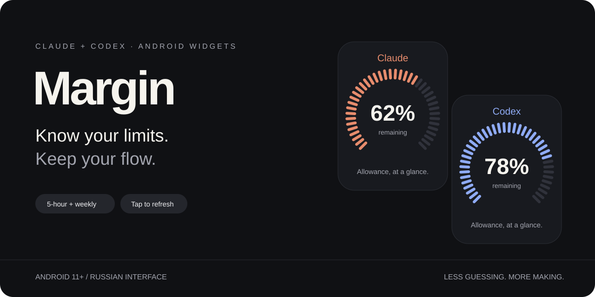
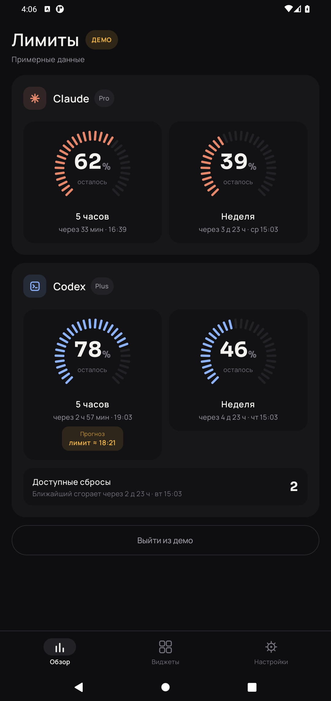
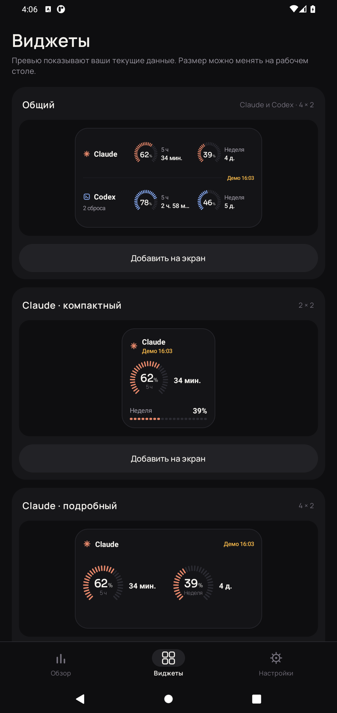
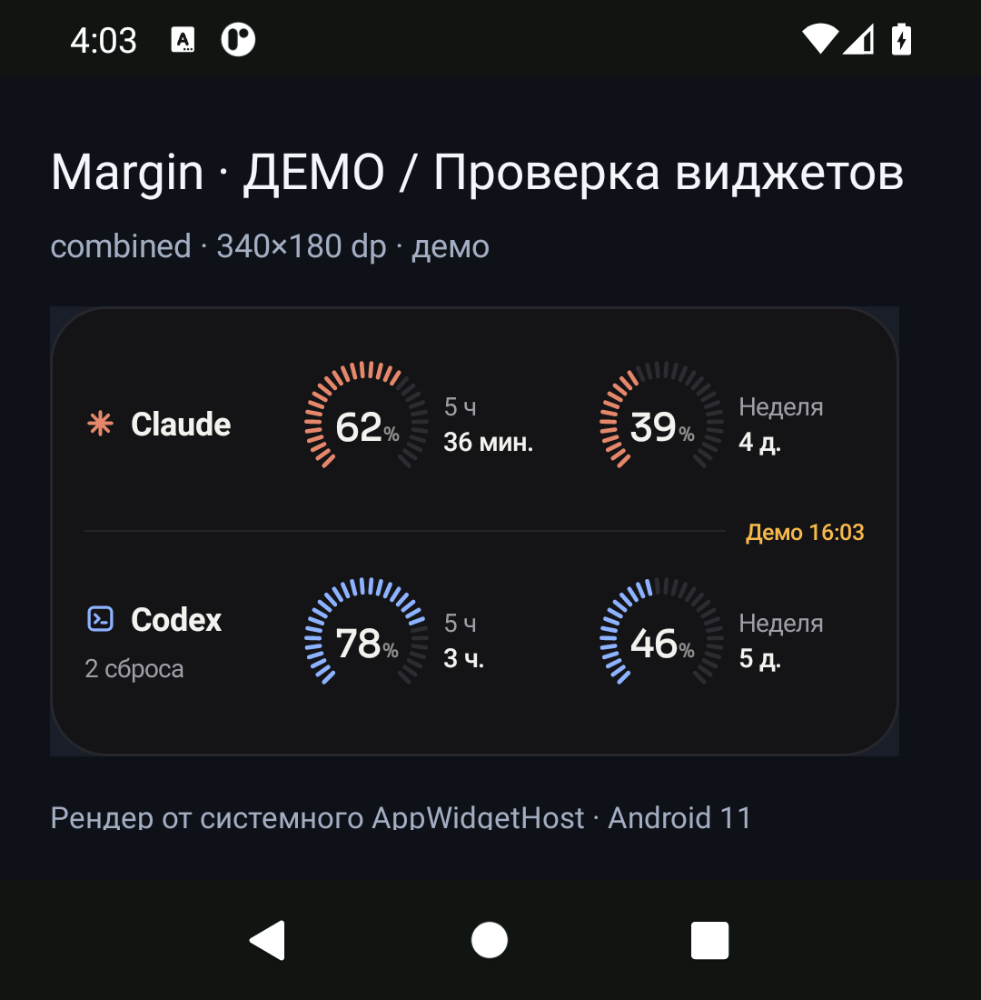
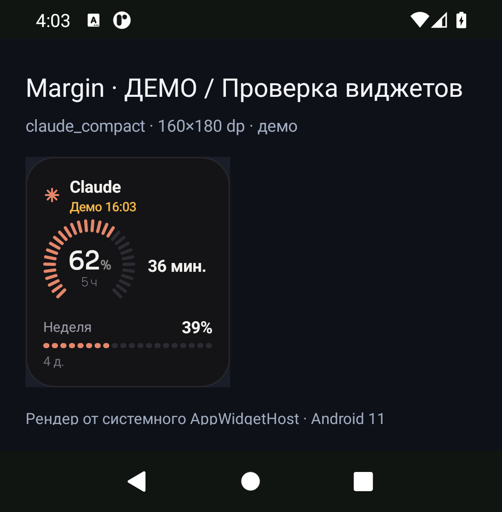

<p align="center">
  
</p>

<p align="center">
  <a href="https://github.com/erofteev-dev/margin-releases/releases/latest"></a>
  
</p>

# Margin

**English** · [Русский](README.ru.md)

**Claude and Codex usage limits, right on your Android home screen.**

See how much of your five-hour and weekly allowance is left, and how long until it resets.
Check your widget before starting your next session.

[**Download the latest APK →**](https://github.com/erofteev-dev/margin-releases/releases/latest)

Android 11+ · Russian-language interface · Claude + Codex

## Your allowance, without opening another app

- **Five home-screen widgets:** a combined Claude + Codex widget, plus compact and wide widgets for each provider.
- **Remaining allowance at a glance.** Tick rings, segmented bars, and percentages show what is left.
- **Time until reset.** Five-hour and weekly windows display a countdown in minutes, hours, or days.
- **Tap a widget to refresh both providers**, with background refresh available as well.
- **In-app overview** with individual quota windows, measurement timestamps, and a conditional exhaustion forecast.
- **Demo mode** to explore the interface without connecting an account.

Unknown values appear as “—”. Different quota windows are kept separate.
Widgets show measured usage; forecasts are available only inside the app.

## A look inside

All screenshots use demo data. The app interface is currently in Russian.

<table>
  <tr>
    <th>Know what is left</th>
    <th>Choose your widget</th>
  </tr>
  <tr>
    <td></td>
    <td></td>
  </tr>
</table>

<details>
<summary><strong>See the combined widget</strong></summary>




</details>

<details>
<summary><strong>See the compact widget</strong></summary>




</details>

Widget screenshots were captured in an Android 11 system widget test host.
The surrounding home-screen appearance depends on your launcher.

## Install

1. Open the [latest release](https://github.com/erofteev-dev/margin-releases/releases/latest).
2. Download `margin-<version>.apk` from **Assets**.
3. Open it on your phone. If prompted, allow your browser or file manager to install apps.
4. Open **Settings** in Margin and connect Claude and/or Codex using your system browser.
   For Claude, copy the authorization code from the browser back into the app.
5. Long-press an empty area of your home screen, choose **Widgets**, and find **Margin**.

To update, install the new APK over your existing installation. You do not need to uninstall:
uninstalling removes local settings and saved sign-ins.

## Your accounts stay on your device

Margin connects directly from your device to the providers, without a Margin relay server.
Sign-in tokens are stored locally in encrypted form using Android Keystore.

Margin is an independent application, not an official Anthropic or OpenAI product.
Compatibility depends on provider OAuth flows and APIs and may change.

## Background refresh

Background refresh is requested every 15 minutes. Android, Doze, and battery restrictions can delay it.
Countdowns are recalculated when the widget is redrawn; they are not live second-by-second timers.
Tap a widget for an immediate refresh attempt.

On MIUI, you may need to enable autostart and allow background activity.
Reopen Margin after force-stopping it.

## Verify your download

Each release includes a `SHA256SUMS-<version>` file containing the APK's SHA-256 checksum.
Updates use the same Margin signing key. Signing certificate SHA-256 fingerprint:

```text
56fa90f85f6faef9e150ad2ddb5617b23f2a944b781b133b994add08b6aae7c3
```

This repository contains the app description, screenshots, and downloadable builds under Releases.
Source code is not published here.
